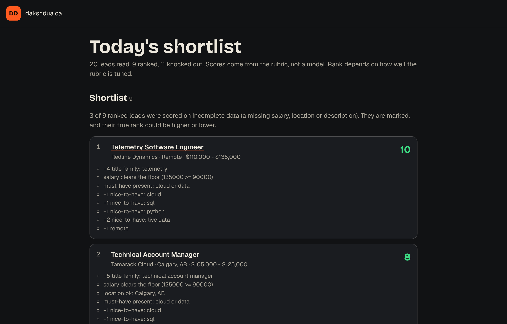
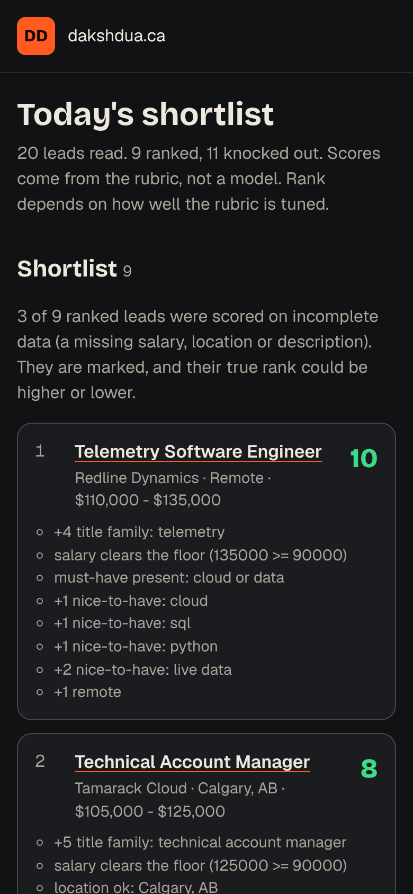
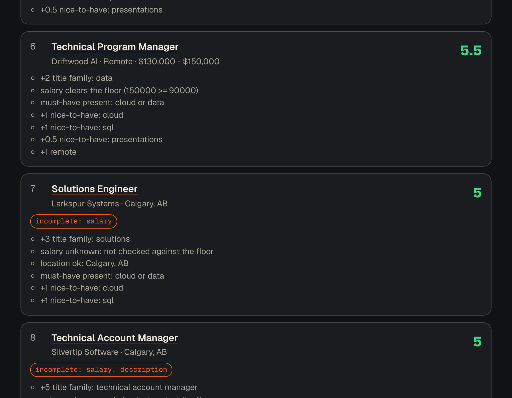

# Résumé Pipeline

**Rank a daily list of job leads against your own rubric, then draft a tailored application. You press send.**

[**See the sample report**](https://daksh2197.github.io/resume-pipeline/) built from invented data. Free, no sign-up, no account.

[](https://github.com/daksh2197/resume-pipeline/actions/workflows/ship.yml)
[](LICENSE)

<p align="center">
  
</p>

## Why I built it

Job alerts arrive as a list every morning. Reading every posting to find the few worth an hour each is the worst part of a job hunt. I wanted the reading done by a rule I wrote down once, and the applying still done by me.

## What it does

- **`screen` ranks a CSV of leads.** `uv run screen jobs.csv --rubric rubric.yaml` writes `ranked.csv` and one HTML report, with the fonts and styles inside the file.
- **Every score has reasons.** "+5 title family: technical account manager". "knockout: salary stated below floor (72000 < 90000)". No model is involved, so the same CSV and rubric give the same answer every time.
- **A missing salary is unknown.** It is not zero and it is not a pass. Those leads are marked, and the report says how many ranked leads were scored on incomplete data.
- **Any CSV layout works.** The rubric maps your column names to the fields the tool needs.
- **The rules are a YAML file.** Title families with weights, must-haves, nice-to-haves, knockouts, a salary floor, location and remote rules, and a company whitelist that skips the salary floor.
- **`pack` builds an application pack prompt.** From one posting and your story bank, it writes a prompt you paste into any assistant. It asks for fit with reasons, gaps stated plainly, five bullets, a note of about 120 words and three questions.
- **`pack --check` rejects invented experience.** Every bullet must cite a story-bank line like `[S2]`, and every number in the reply, in any section, must appear in the story bank. A reply that breaks either rule is rejected with a plain message. It compares whole-token digits and number words, not units, ordinals or non-Latin numerals, so read the pack before you send it.



## What it will not do

It does not apply for you, submit forms, scrape LinkedIn, Indeed or any job board, or guess recruiter emails. That breaks site rules, gets accounts restricted, and untailored volume converts worse. The tool ends at a draft and a ranked list. I press send.

Ranking quality depends on your rubric. A loose rubric puts everything on the shortlist. A strict one knocks out the lead you wanted. [docs/THE-RUBRIC.md](docs/THE-RUBRIC.md) shows how to tune it by reading the reasons.

## The hard part in 30 seconds

Scoring is a fixed list of checks, in this order:

```
no title           -> can't be scored
knockout phrase    -> out, whatever else it earns
salary floor       -> out if the TOP of the stated range is under the floor (whitelist skips this)
location / remote  -> out if the rules say so
must-haves         -> out if one is missing (unchecked if there is no description)
points             -> best title family once + nice-to-haves + remote bonus
```

One invented posting, scored by hand: Technical Account Manager at Tamarack Cloud, Calgary, `$105,000 - $125,000`. Title family +5, then cloud +1, SQL +1, Python +1. Total 8. The report lists seven reason lines for it: the four that earn points, plus the salary, location and must-have checks it passed. The full walk-through is in [docs/THE-RUBRIC.md](docs/THE-RUBRIC.md).



## Run it yourself

You need [uv](https://docs.astral.sh/uv/). It installs Python and the one dependency for you.

```bash
git clone https://github.com/daksh2197/resume-pipeline.git
cd resume-pipeline
uv sync
uv run screen samples/jobs.csv --rubric samples/rubric.yaml --out out --sample   # open out/report.html
uv run pytest                                                                      # every test, in under a second
```

For your own search, copy the sample rubric, then point `screen` at your export:

```bash
cp samples/rubric.yaml rubric.yaml     # edit the columns: block to match your CSV's headers
uv run screen jobs.csv --rubric rubric.yaml
```

The application pack, with no model needed:

```bash
cp samples/story-bank.md story-bank.md          # replace the lines with your own, numbered S1, S2, ...
uv run pack posting.txt --story-bank story-bank.md       # writes prompt.md
# paste prompt.md into any assistant, save its answer as reply.md
uv run pack --story-bank story-bank.md --check reply.md  # passes, or says what is wrong
```

`samples/sample-reply.md` is a hand-written reply that passes the check. Your real `jobs.csv`, `rubric.yaml`, `story-bank.md`, `posting.txt` and packs are ignored by git (see `.gitignore`). Only `samples/` is committed, and everything in it is invented.

An n8n workflow in [`n8n/`](n8n/) runs `screen` and returns the top ten. I imported it into n8n 2.35.7 and ran it. The details, and what I did not check, are in [n8n/README.md](n8n/README.md).

A daily schedule without any extra tool: [`examples/daily.yml`](examples/daily.yml) is a GitHub Actions workflow for a private repo that holds your leads.

## How it's built

| Piece | Job | Why this one |
| --- | --- | --- |
| Python 3.11+ | The language | Reads CSVs and text well, and I can read it back |
| `uv` | Installs Python and packages, runs commands | One tool, and `uv.lock` pins every version |
| PyYAML | Reads the rubric | The rules are a plain text file, not code |
| `pytest` | The tests | Test names are plain sentences, so the file reads like a spec |
| `ruff` | Lint and format | Fast, and CI runs it |
| No framework, no model | Everything else | A rule I wrote can be explained. A score from a model can't |
| GitHub Actions and Pages | Test on every push, host the sample report | Free |

The map:

```
src/resume_pipeline/
  rubric.py     reads rubric.yaml and refuses a bad one with a plain message
  leads.py      reads the CSV through the rubric's column mapping
  salary.py     turns "$98k-118k" or "$22/hour" into a yearly range, or says unknown
  scoring.py    the checks above. Start here.
  report.py     ranked.csv and the HTML report
  pack.py       builds the application-pack prompt and checks a reply
  textio.py     reads text files saved as UTF-8 or old Windows encodings
  cli.py        the two commands
  assets/       brand.css and the three typefaces (SIL Open Font License)
samples/        invented leads, rubric, story bank, posting and reply
tests/          the tests, plus tests/golden/report.html
scripts/        regen_golden.py, for when you change the report on purpose
docs/           THE-RUBRIC.md, CTO-NOTES.md, BUSINESS.md, screenshots
n8n/             one workflow, run in a real n8n instance
examples/daily.yml            the same schedule on GitHub Actions
.github/workflows/ship.yml    lint, test, build, then deploy the sample report
```

Want the guided tour? [docs/CTO-NOTES.md](docs/CTO-NOTES.md) explains every idea in here in plain English, how to debug it, and five small changes to try. The money side is in [docs/BUSINESS.md](docs/BUSINESS.md).

## What got caught along the way

- **The guardrail caught my own sample.** The first hand-written sample reply asked "what does a good first 90 days look like". The number 90 is not in the story bank, so `pack --check` rejected it. I changed the question to "first quarter". That is the rule working on the person who wrote it.
- **List numbers looked like experience.** The same check flagged "1", "2" and "3" in the questions list, because it was reading the list markers as numbers. A test now covers it.
- **A number passed because the same digits were hiding somewhere else.** The check looked for digits, so a reply that said "level 4" passed when my story bank only had "L4", and "21" passed because the bank had "2021". It now reads a number as a whole token on both sides, so letters or other digits stuck to it do not count. "L4", "S21" and "1,200" no longer give up a 4, a 21 or a 200. Tests cover each case.
- **A spreadsheet reads a leading plus as a formula.** The first `ranked.csv` had reasons starting with `+4 title family...`, and every row came out with a stray apostrophe, because the formula guard I'd added was catching my own text. The reasons cell now starts with "Reasons:", and only lead text that starts with `=`, `+`, `-` or `@` gets the apostrophe.
- **A tie test that tested the wrong thing.** I first wrote the tie-break test as "ties keep the order they arrive in". The rule is "ties keep the order of the CSV", which is the row number, whatever order the code receives them. The test now shuffles the input.

## How this was built

I build with Claude as my pair programmer. I bring the problem and decide what the thing should do. Claude writes most of the code. I review it until I can explain every file, and [the CTO notes](docs/CTO-NOTES.md) are my study guide, in public. Every commit carries the co-author line.

## What's next

- [ ] `pack --ollama <model>`: call a local model directly. Left out because I could not run and verify it in the environment this was built in.
- [ ] Let the n8n schedule trigger fire on its own once. I ran the workflow from the manual trigger only.
- [ ] A demo GIF. The README uses screenshots of the real report for now.
- [ ] Check `examples/daily.yml` on a real schedule. Its commands run locally. The workflow itself has not run on GitHub yet.
- [ ] Rubric packs per role family

Ideas and pull requests are welcome. If a lead is ranked somewhere that surprises you, [open an issue](https://github.com/daksh2197/resume-pipeline/issues) with the rubric line that caused it. Please leave real postings and personal details out.

## Data

Every lead, company and posting in `samples/` is invented. The example links go to `example.com`. Nothing in this repo is fetched from a job board, and the tool never visits one. The three typefaces (Bricolage Grotesque, Geist, Geist Mono) are under the [SIL Open Font License 1.1](src/resume_pipeline/assets/fonts), copied from the `@fontsource-variable` packages on 14 October 2026.

Not affiliated with any employer, job board or company named in the samples. The company names are made up.

## License

[MIT](LICENSE). Use it, fork it, put it inside your own job search.

Built in Calgary by [Daksh Dua](https://dakshdua.ca).
